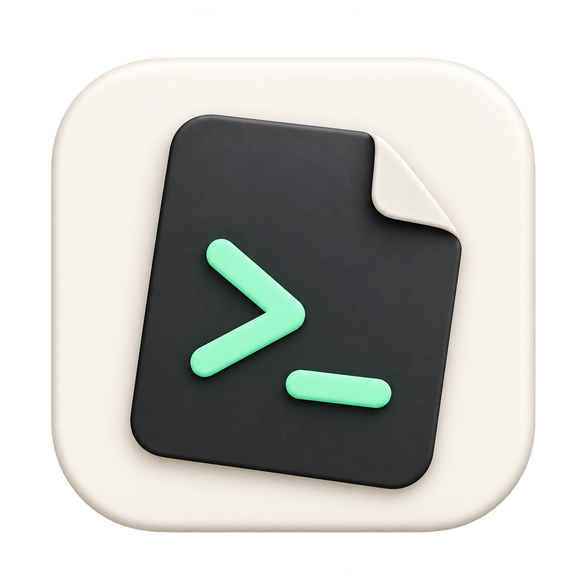

# Nc2Shell



面向 macOS 的原生 SSH 与 SFTP 客户端，把连接管理、交互终端和远程文件放在同一个工作区。

界面使用 SwiftUI + AppKit，终端基于 SwiftTerm 1.18.0，SSH 使用系统 `/usr/bin/ssh`。文件传输通过已认证的 SSH 连接使用 SFTP，不需要再次登录。

当前代码版本：**0.12.20 / build 39**。运行要求 **macOS 14 或更新版本**，目前交付和验证以 **Apple Silicon** 为准。应用采用本机 ad-hoc 签名，尚未经过 Apple 公证；项目采用 [MIT 许可证](LICENSE)。

## 功能

| 模块 | 当前支持 |
| --- | --- |
| 连接与认证 | 保存、编辑和搜索连接；密码、私钥、系统 SSH 默认配置；可选记住密码到 macOS Keychain |
| 终端工作区 | 多标签；每标签最多两个独立 SSH 窗格；上下或左右分屏；可收起、调宽的连接栏与文件栏 |
| 终端体验 | 深夜、明亮、Solarized 深色主题；字号、回滚行数和 Option 行为设置；内容查找、自定义快捷键、手动会话日志 |
| 目录导航 | 跟随远端真实工作目录；手动浏览、前进后退、面包屑、目录收藏；排序、筛选、隐藏文件和递归名称搜索 |
| 文件管理 | 上传、下载、批量下载、Finder 拖入及拖出；新建目录、重命名、删除、属性、复制路径、同服务器复制或移动 |
| 传输管理 | 并行队列、暂停、取消、上传/下载限速；冲突处理；可选保留普通权限和修改时间；手动断点续传 |
| 连接恢复 | 可按连接启用异常断开后自动重连一次；保留旧终端的纯文字输出 |

## 构建与安装

### 准备环境

- macOS 14+；目前已验证的硬件为 Apple Silicon，Intel Mac 尚未实机验证。
- Xcode 开发工具，包含 Swift 6.0+、Swift Package Manager 和支持 macOS 14 的 SDK。虽然项目包清单声明 Swift tools 5.9，当前锁定的间接依赖要求 Swift 6.0。
- Python 3.9+，用于应用打包和可选回环测试；已打包应用运行时不依赖 Python。
- 首次构建需要联网获取 Swift Package Manager 依赖。

远端需要可访问的 SSH 服务。文件功能还需要 SFTP 子系统；自动目录跟随需要远端允许额外的 SSH exec 通道并具备相应 Shell 和标准工具。

### 从源码生成应用

取得源码后，在项目根目录运行：

```bash
bash scripts/build-app.sh
```

脚本会构建 release 二进制、打包图标和依赖资源，并执行本机 ad-hoc 签名与签名校验。完成后的应用位于：

```text
dist/Nc2Shell.app
```

可以直接打开构建产物：

```bash
open dist/Nc2Shell.app
```

需要长期使用时，在 Finder 中将 `dist/Nc2Shell.app` 拖入“应用程序”目录。替换已有版本前，先结束或妥善保存远程任务、等待传输停止，并退出旧应用。

构建脚本只生成 `.app`，不会自动安装，也不生成 ZIP、DMG 或 PKG。当前没有自动更新功能，更新时需要重新构建并替换应用。由于尚未公证，在其他 Mac 上分发和启动可能受到系统安全策略限制。

## 使用方法

### 1. 添加并连接服务器

点击左下角“新建连接”，填写连接名称、主机、端口和用户名，然后选择认证方式：

| 认证方式 | 使用说明 |
| --- | --- |
| 密码 | 填写密码时需要明确用户名。不勾选记住时只保存在本次应用内存中；勾选后保存到 macOS Keychain。也可以留空，在终端中完成认证。 |
| 私钥 | 选择本机已有私钥文件；私钥口令在连接时输入。应用不读取或导出私钥内容，也不修改 SSH 配置。 |
| SSH 默认配置 | 使用系统 SSH 配置、默认密钥和密钥代理；连接过程中仍可手动输入所需凭据。 |

例如，可以用 `server.example` 和 `user` 理解主机、用户名字段；它们只是示例，并非可用的服务器配置。

“保存”只保存配置。随后点击连接条目旁的三角按钮，或选择条目后按 `⌘Return` 建立会话。首次连接时需要确认主机指纹；遇到口令或其他认证提示，可直接在终端中操作。认证成功后才会显示已连接状态。

密码自动填入仅尝试标准密码认证一次。需要多因素认证或希望自行输入时，可在终端工具栏菜单中选择“手动认证重新连接”。更换主机、端口或用户名后，需要重新提供对应账户的密码。

### 2. 使用标签、分屏和设置

- 使用工具栏的新建会话按钮打开更多会话；每个窗格都有独立的 SSH 进程和终端状态。
- 使用分屏菜单或快捷键创建上下、左右两个窗格；点击窗格切换焦点，文件面板跟随当前焦点窗格。
- 首次进入左右分屏时，左右侧栏会收起以留出终端空间，也可以手动重新展开。
- 点击齿轮或按 `⌘,` 打开设置。终端、快捷键、传输三页统一保存；取消或按 Esc 会丢弃未保存修改。

终端默认字号为 16pt、回滚历史为 10,000 行，Option 默认作为 Alt/Meta。设置中可调整字号、历史容量、主题和 Option 输入行为。

### 3. 浏览与传输文件

连接成功后，右侧文件面板复用当前 SSH 登录。支持通过工具栏上传/下载，也支持从 Finder 拖入文件或文件夹、将远程所选项目拖到 Finder 下载。

- **目录跟随**：面板以远端实际报告的目录为准；手动浏览会暂停跟随，点击“恢复跟随”可重新启用。没有有效报告时显示等待或暂缓状态。
- **管理文件**：右键菜单提供复制路径、属性、复制到、移动到、重命名和删除等操作。删除和整目录替换不可撤销，执行前会显示确认。
- **处理冲突**：按提示选择覆盖、跳过、保留两份或取消本批；目录冲突还可选择合并或整目录替换。
- **查看队列**：打开“传输管理与待恢复任务”，查看进度、暂停或取消任务。默认每会话并行 2 项，可在设置中调整为 1–4 项。
- **限速与属性**：上传、下载分别设置全局限速，`0` 表示不限速。保留权限和修改时间默认关闭，需要在设置中开启。

拖入文件夹行时，上传目标仍是面板当前目录。传输任务会固定创建时的来源和目标，之后切换目录或窗格不会更改该任务的路径。

### 4. 恢复连接与传输

连接编辑窗口中可开启“异常断开后自动重连一次”，默认关闭。它仅适用于已认证会话的特定异常退出，等待 3 秒后尝试一次；不重放命令、不自动续传，也不重新启动会话日志。

传输中断后，在“传输管理与待恢复任务”中查看恢复记录，连接原服务器，再手动点击“续传”。续传前会校验来源和已有内容；发现变化或无法确认安全状态时会停止。应用重启不会自动连接服务器或开始传输。

“移除记录”仅移除恢复任务描述，不删除文件或检查点。需要清理半成品时，使用“检查并清理…”查看预览后确认；不要仅凭文件名前缀手动批量删除暂存文件。

### 5. 常用快捷键

以下为默认快捷键；除固定的 `⌘,` 外，其余可在设置中调整。普通 Ctrl 组合保留给终端。

| 操作 | 快捷键 |
| --- | --- |
| 新建连接 | `⌘N` |
| 连接所选服务器 | `⌘Return` |
| 左右 / 上下分屏 | `⌘D` / `⌘⇧D` |
| 切换焦点窗格 | `⌘⌥]` |
| 查找终端内容 | `⌘F` |
| 下一项 / 上一项 | `⌘G` / `⌘⇧G` |
| 放大 / 缩小 / 恢复默认字号 | `⌘=` / `⌘-` / `⌘0` |
| 开始 / 停止会话日志 | `⌘⇧L` |
| 关闭当前窗格 | `⌘⇧W` |
| 打开设置 | `⌘,` |

## 数据与隐私

应用配置位于本机的 `~/Library/Application Support/Nc2Shell/`：

| 文件或目录 | 内容 |
| --- | --- |
| `connections.json` | 连接名称、主机、端口、用户名等配置，不含密码 |
| `terminal-settings.json` | 终端外观、回滚、Option 行为和快捷键 |
| `transfer-settings.json` | 传输并发、限速和属性选项 |
| `remote-directory-bookmarks.json` | 绑定连接与账户的目录收藏 |
| `transfer-recovery/` | 恢复任务描述、检查点及锁文件 |

记住的密码另存于 macOS Keychain；未记住的密码只保留在应用内存中。连接配置、收藏和恢复记录虽然不含密码，仍可能包含服务器地址、用户名与本地或远程路径，不应上传到公开仓库。

会话日志默认关闭，仅在认证成功后由用户选择新文件开启，记录后续远端输出。日志不读取键盘输入，但远端回显仍可能包含密码、令牌或其他敏感内容，分享前需要检查。

应用保留 SSH 主机密钥校验，并禁止远端通过 OSC52 读写本机剪贴板。JSON 配置损坏或不可读时会显示错误并阻止覆盖，不应通过删除整个应用数据目录来处理加载问题。

## 当前限制

- **平台与分发**：仅面向 macOS 14+；Intel Mac 未实机验证。尚未做 Apple 公证，不提供 App Store 分发或自动更新。
- **工作区与功能范围**：每个标签最多两个窗格。当前没有远程文本编辑器、高级连接配置页面、连接分组、配置导入导出、云同步或脚本面板。
- **目录跟随**：支持已验证的原 Shell，以及同用户、同服务器默认 tmux 环境。嵌套 SSH、身份切换、自定义 tmux socket、其他前台程序或无法确认的环境会暂停跟随；文件面板仍属于原连接。远端限制 exec 通道或 SSH 会话数量时，该功能可能不可用。
- **Shell 集成**：不修改远端启动配置文件。Bash 集成会话的 `login_shell` 为 false，不自动执行 `.bash_logout`；动态主题、启动脚本重置钩子等情况可能影响提示符或目录报告。Bash/Zsh 标准提示符可缩短为最后两级路径，Fish 和动态自定义主题保留原提示符。
- **自动重连**：不是持续重试机制。首次认证失败、普通退出等情况不会触发；ProxyJump、ProxyCommand 或 Match 动态配置需要手动重连。重连只保留旧输出的纯文字，不恢复 vim/top 等全屏程序状态。
- **文件类型与属性**：不跟随符号链接，符号链接或特殊文件不能作为普通上传/下载及修改对象。权限编辑限单个普通文件或目录的 rwx；传输属性仅支持普通权限和秒级修改时间，不复制所有者、特殊权限位、ACL 或扩展属性。
- **一致性与恢复**：SFTP v3 不提供跨进程对象锁或事务。暂存、备份和检查点能降低风险，但无法保证识别所有外部并发修改或断电场景。同服务器移动跨文件系统失败时，不会自动改为复制后删除。
- **递归搜索**：按名称、不区分大小写进行包含匹配，最多返回 1,000 项、递归 64 层，不跟随符号链接；遇到上限或不可访问目录时会提示。
- **验证范围**：未全面覆盖所有 Linux 发行版、Shell 定制、sudo/su、输入法、多屏缩放、VoiceOver 或 Finder 跨窗口手势。已有自动测试不等同于这些场景都已完成实机验收。

## 开发与测试

项目由 Swift Package Manager 管理。开发约定与模块边界见 [AGENTS.md](AGENTS.md)。

### 普通测试

```bash
bash scripts/swift.sh test
```

没有隔离 SSH 夹具或可选 Shell 工具时，相应集成测试会明确跳过，不能将跳过项记为通过。

### 本地回环 SSH/SFTP 测试

测试服务只监听 `127.0.0.1`，在 `work/` 下创建临时目录，并生成独立密码、密钥和 known_hosts；正常结束后自动回收。不要用真实服务器、连接配置或凭据替代测试夹具。

首次准备 Python 测试环境：

```bash
python3 -m venv work/ssh-test-venv
work/ssh-test-venv/bin/python -m pip install paramiko
```

先按上面的构建步骤生成已签名应用，再运行：

```bash
NC2SHELL_TEST_ASKPASS_EXECUTABLE="$PWD/dist/Nc2Shell.app/Contents/MacOS/Nc2Shell" \
  work/ssh-test-venv/bin/python scripts/integration-smoke.py
```

可在命令末尾追加 `--filter 'SessionTests|RemoteDirectoryBookmarkTests'` 来选择用例。Fish/tmux 测试还需要通过 `NC2SHELL_TEST_FISH`、`NC2SHELL_TEST_TMUX` 指定可执行文件；使用独立 terminfo 时设置 `NC2SHELL_TEST_TERMINFO`。这些可选工具及本机验证记录不随源码发布，未提供时相关用例会跳过。

测试创建会话时显式注入隔离的临时目录收藏，避免读取本机真实收藏。不要给整个回环服务额外套用会阻止进程观察或改变特殊权限位的沙箱，否则可能改变被测行为。

### 主要目录

| 目录 | 用途 |
| --- | --- |
| `Sources/Nc2Shell/` | 应用界面、终端会话、文件面板和传输生命周期 |
| `Sources/Nc2ShellCore/` | 连接、SSH 参数、Shell 集成、SFTP、存储和恢复逻辑 |
| `Sources/Nc2ShellAuthSupport/` | askpass 身份校验所需的系统认证支持 |
| `Tests/` | 核心逻辑及会话、窗口、SSH/SFTP 集成测试 |
| `scripts/` | SwiftPM 包装、应用打包和回环测试服务 |
| `Assets/` | 应用图标源图及 ICNS |

`.build/`、`dist/` 和 `work/` 是本机构建、运行或验证产物，不纳入 Git。提交问题或改动时，请先移除日志、截图和样例中的服务器地址、账户、凭据及私人路径。

## 许可证

本项目采用 [MIT 许可证](LICENSE)，版权署名为 `Copyright (c) 2026 Nc`。授权条件与免责条款以许可证全文为准。

第三方依赖继续适用各自的许可证及归属要求，不因本项目采用 MIT 而改变。应用打包时会保留 SwiftTerm 的许可证文件。
